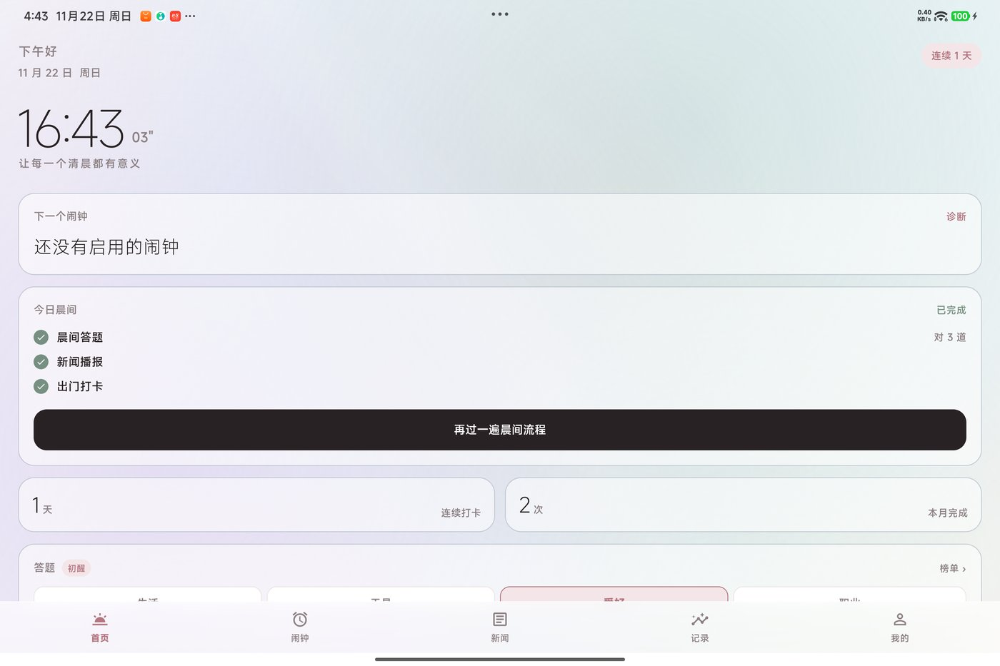

# 晨序 MORNING

**让每一个清晨都有意义。**

一款 Android 智能闹钟 + 晨间习惯闭环 App：**唤醒 → 答题提神 → 新闻播报 → 出门打卡**，把赖床的时间变成一天中最有价值的十分钟。

| 首页 | 闹钟 | 新闻 |
|:---:|:---:|:---:|
|  |  |  |
| **记录** | **我的** | |
|  |  | |

---

## ✨ 它能做什么

### ⏰ 真闹钟，不是提醒
- 响铃走系统级 `AlarmClock` 通道，**锁屏直达全屏响铃页**，灭屏、重启后依然有效
- 贪睡、答题解锁可自由搭配：想关掉闹钟？先答对几道题再说
- 开机自动重注册闹钟，升级 App 不丢闹钟

### 🧠 晨间答题（3224 道题库）
- 覆盖社会 / 文化 / 科技 / 军事 / 国际 / 体育 / 生活 等 10+ 分类
- 内置兴趣画像：答得越多，题目越对胃口（清晰度会随答题提升）
- 自定义每轮题量：3 / 5 / 10 / 20 / 50 道，或全部

### 📰 每日新闻 + 语音播报
- 自动抓取当日新闻，支持「今日 / 本地 / 全部」三种视图
- 一键**连续播报 15 条**，洗漱时当早间电台听
- 语音走系统 TTS 并自动挑选中文女声音色，断网也能播内置内容

### 📷 出门打卡 & 记录
- 晨间流程完成后拍照打卡，形成连续打卡记录
- 记录页按日汇总：打卡、答题对错、看过的新闻，一目了然

### 🎨 界面
- 原纸 / 水晶 / 流光三档玻璃质感主题，播报语速三档可调
- Android 8+ 自适应图标，手机、平板布局均已适配

---

## 📱 支持设备

| 项目 | 要求 |
|---|---|
| 系统 | **Android 8.0 及以上**（targetSdk 34，Android 14） |
| 设备 | 手机、平板均可（平板横屏已适配） |
| 网络 | 可选——闹钟/答题完全离线可用，新闻与播报需联网 |
| 权限 | 通知、精确闹钟、（可选）相机用于打卡。国产系统（MIUI / EMUI / ColorOS）建议在「我的 → 权限诊断」中允许自启动并关闭电池优化，避免响铃延迟 |

已实测机型：小米平板（24018RPACC，Android 16）、小米 / 红米手机（MIUI）。

---

## ⬇️ 下载安装

- **GitHub Releases**：https://github.com/xia259214-beep/morning-app/releases —— 下载最新的 `morning-vX.Y.Z.apk` 直接安装（无需签名校验，卸载重装数据会清空）
- **官网下载页**：https://xia259214-beep.github.io/morning-app/

> 更新版本直接覆盖安装即可，本地数据（闹钟、打卡记录、答题画像）不会丢失。

---

## 🚀 三分钟上手

1. **装好打开**，首次进入按引导授予通知与闹钟权限（进「我的 → 权限诊断」可逐项检查）
2. **底部第二个标签「闹钟」**：点右上角 ➕ 新建闹钟，设定时间、贪睡分钟数、答题题数
3. **早上闹铃响起**：锁屏上直接出现全屏响铃页 → 选择「起床」（或先答几道题清醒一下）
4. **跟着晨间流程走**：首页「再过一遍晨间流程」→ 晨间答题 → 新闻播报 → 出门拍照打卡
5. 打卡成功，首页连续打卡 +1 ✅

---

## ⚠️ 已知边界

- 任何第三方闹钟都无法承诺 100% 不漏响：用户手动「强行停止」、极端省电策略会让系统杀掉闹钟调度，请按机型做权限设置
- 无账号 / 云同步，卸载或换机数据不保留（云同步在路线图中，见 `docs/`）
- 新闻为公开渠道聚合，仅供晨间速览

---

## 🛠️ 给开发者

纯 Flutter + Kotlin 原生实现，**零第三方依赖**（无 pub 插件、无原生库），核心能力全部走 Kotlin 原生桥。

```
lib/
  main.dart           入口 + 五导航外壳 + 响铃拉起跳转
  core.dart           设计系统 / 数据模型 / 原生桥 / 本地存储 / 题库
  morning_news.dart   真实新闻引擎桥接（断网回落示例数据）
  speech.dart         播报文本净化 / 语速控制
  crash_log.dart      三层全局崩溃捕获，落盘 crash_log.txt
  pages_home.dart     首页
  pages_alarms.dart   闹钟列表 + 编辑
  pages_morning.dart  晨间标签页 + 晨间流程
  pages_more.dart     记录 / 我的 / 权限诊断
android/.../kotlin/cn/morning/morning/
  MainActivity.kt     原生桥（15 个方法，含 TTS 音色挑选）
  AlarmStore.kt       闹钟调度中枢（setAlarmClock / 降级 / 兜底通知）
  RingActivity.kt     全屏响铃页（原生，锁屏直达）
  BootReceiver.kt     开机 / 改时间 / 升级后重注册
```

### 构建

需要 JDK 17、Android SDK 34、Flutter 3.24.5+。

```bash
export JAVA_HOME=/d/dev/tool/jdk/jdk-17.0.2
export ANDROID_HOME=/d/dev/tool/android-sdk
flutter pub get
flutter build apk --release
# 产物：build/app/outputs/flutter-apk/app-release.apk
```

国内网络可加镜像：

```bash
export PUB_HOSTED_URL=https://pub.flutter-io.cn
export FLUTTER_STORAGE_BASE_URL=https://storage.flutter-io.cn
```

### 测试

```bash
flutter test          # 182 项测试全通过
```

界面测试需要本机有中文字体（默认加载 `C:\Windows\Fonts\Deng.ttf`）。

### 发版注意

1. release 目前用 debug 签名（下载即可装），正式发布请换自己的 keystore
2. `applicationId` 为 `cn.morning.morning`，确定正式包名后再改（改了不能覆盖安装）

---

## 📜 版本历史

- **v1.13.1**（2026-11-22）— **强制播报闭环**：一天可贪睡 2 次，第三次响铃直接进入「晨间播报」——铃声换成当天新闻播报，不能关、不能退、按 Home 也会被系统闹钟拉回，只有拍了门外照片打卡才能结束。出门判定 v1：先在「我的 → 出门基准照」登记门口/电梯/路边照片，打卡时自动比对，不像门外会拦下重拍（3 张未过记为「存疑」）。真机实测：贪睡→再贪睡→强制播报→拍照打卡全链路通过，183 项测试全过
- **v1.12.2**（2026-11-22）— 修复提前结束答题丢失成绩：`QuizPane.onEarlyStop` 改为携带 `QuizTally`，晨间完成页/答题小结不再显示「答题 0 题」（此前答了七八道、点「先停一下」后成绩归零）。新增回归用例 `test/quiz_early_stop_test.dart`。真机 25 轮压测 0 崩溃，记录见 `docs/稳定性测试_2026-11-22.md`。
- **v1.12.1**（2026-11-22）— 播报音色修复：真实新闻退回系统 TTS 时自动挑选本地中文女声，不再用引擎默认的单薄音色
- **v1.12.0**（2026-11-22）— 品牌视觉对齐：「立体晨金·波纹」新图标 + Android 8+ 自适应图标，应用名统一为「晨序MORNING」
- **v1.11.0**（2026-11-22）— 零依赖本地崩溃日志（三层全局捕获，64KB 滚动落盘），预留 Bugly 接入点
- **v1.10.0**（2026-11-21）— 晨间播报接入真实新闻引擎，文本净化补漏
- **v1.9.0** — 玻璃质感三档主题、播报语速三档、五 tab 导航

完整更新说明见 [Releases](https://github.com/xia259214-beep/morning-app/releases)。
