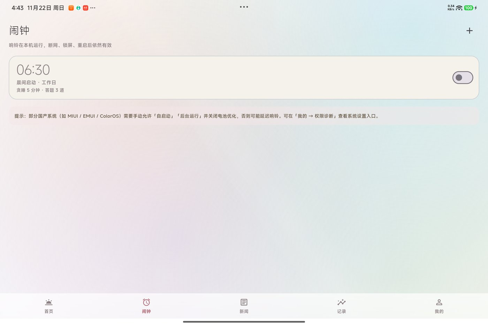
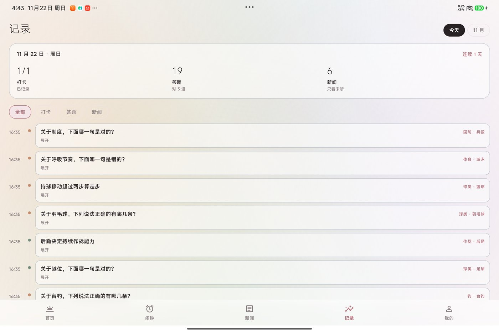
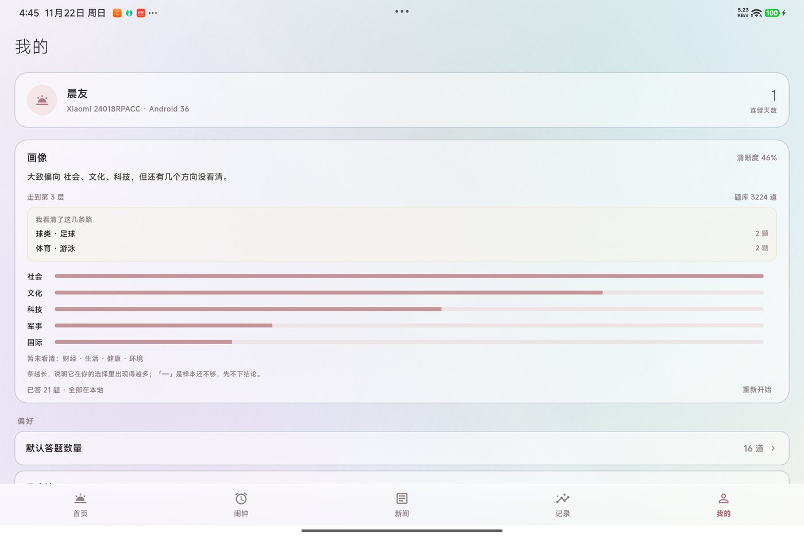

# 晨序 MORNING

**让每一个清晨都有意义。**

一款 Android 智能闹钟 + 晨间习惯闭环 App：**唤醒 → 答题提神 → 新闻播报 → 出门打卡**，把赖床的时间变成一天中最有价值的十分钟。

| 首页 | 闹钟 | 新闻 |
|:---:|:---:|:---:|
|  |  |  |
| **记录** | **我的** | |
|  |  | |

---

## ✨ 它能做什么

### ⏰ 真闹钟，不是提醒
- 响铃走系统级 `AlarmClock` 通道，**锁屏直达全屏响铃页**，灭屏、重启后依然有效
- 贪睡、答题解锁可自由搭配：想关掉闹钟？先答对几道题再说
- 开机自动重注册闹钟，升级 App 不丢闹钟

### 🧠 晨间答题（3224 道题库）
- 覆盖社会 / 文化 / 科技 / 军事 / 国际 / 体育 / 生活 等 10+ 分类
- 内置兴趣画像：答得越多，题目越对胃口（清晰度会随答题提升）
- 自定义每轮题量：3 / 5 / 10 / 20 / 50 道，或全部
- **答题计分**：答对 +1、答错 −1、跳过不计，总分在「我的」「画像卡」「答题页」都能看到

### 💾 数据搬家（换手机不丢）
- 「我的 → 数据备份 / 换手机」一键导出 JSON：存本地、存网盘、发给自己都行
- 新手机导入时可选**合并**（补齐缺的）或**覆盖**（整份替换，且先自动留底可撤销）
- 全程不经过任何服务器，不需要账号，也不需要存储权限

### 📰 每日新闻 + 语音播报
- 自动抓取当日新闻，支持「今日 / 本地 / 全部」三种视图
- 一键**连续播报 15 条**，洗漱时当早间电台听
- 语音走系统 TTS 并自动挑选中文女声音色，断网也能播内置内容

### 📷 出门打卡 & 记录
- 晨间流程完成后拍照打卡，形成连续打卡记录
- 记录页按日汇总：打卡、答题对错、看过的新闻，一目了然

### 🎨 界面
- 原纸 / 水晶 / 流光三档玻璃质感主题，播报语速三档可调
- Android 8+ 自适应图标，手机、平板布局均已适配

---

## 📱 支持设备

| 项目 | 要求 |
|---|---|
| 系统 | **Android 8.0 及以上**（targetSdk 34，Android 14） |
| 设备 | 手机、平板均可（平板横屏已适配） |
| 网络 | 可选——闹钟/答题完全离线可用，新闻与播报需联网 |
| 权限 | 通知、精确闹钟、（可选）相机用于打卡。国产系统（MIUI / EMUI / ColorOS）建议在「我的 → 权限诊断」中允许自启动并关闭电池优化，避免响铃延迟 |

已实测机型：小米平板（24018RPACC，Android 16）、小米 / 红米手机（MIUI）。

---

## ⬇️ 下载安装

- **GitHub Releases**：https://github.com/xia259214-beep/morning-app/releases —— 下载最新的 `morning-vX.Y.Z.apk` 直接安装（无需签名校验，卸载重装数据会清空）
- **官网下载页**：https://xia259214-beep.github.io/morning-app/

> 更新版本直接覆盖安装即可，本地数据（闹钟、打卡记录、答题画像）不会丢失。

---

## 🚀 三分钟上手

1. **装好打开**，首次进入按引导授予通知与闹钟权限（进「我的 → 权限诊断」可逐项检查）
2. **底部第二个标签「闹钟」**：点右上角 ➕ 新建闹钟，设定时间、贪睡分钟数、答题题数
3. **早上闹铃响起**：锁屏上直接出现全屏响铃页 → 选择「起床」（或先答几道题清醒一下）
4. **跟着晨间流程走**：首页「再过一遍晨间流程」→ 晨间答题 → 新闻播报 → 出门拍照打卡
5. 打卡成功，首页连续打卡 +1 ✅

---

## ⚠️ 已知边界

- 任何第三方闹钟都无法承诺 100% 不漏响：用户手动「强行停止」、极端省电策略会让系统杀掉闹钟调度，请按机型做权限设置
- **没有云同步服务器**：数据只在本机。换手机请用「我的 → 数据备份 / 换手机」导出 JSON 再导入；卸载 App 会连私有目录一起清掉，卸载前记得先导出
- 打卡照片不进备份（体积大），换机后照片位置会空着，记录本身还在
- 新闻为公开渠道聚合，仅供晨间速览

---

## 🛠️ 给开发者

纯 Flutter + Kotlin 原生实现，**零第三方依赖**（无 pub 插件、无原生库），核心能力全部走 Kotlin 原生桥。

```
lib/
  main.dart           入口 + 五导航外壳 + 响铃拉起跳转
  core.dart           设计系统 / 数据模型 / 原生桥 / 本地存储 / 题库
  morning_news.dart   真实新闻引擎桥接（断网回落示例数据）
  speech.dart         播报文本净化 / 语速控制
  crash_log.dart      三层全局崩溃捕获，落盘 crash_log.txt
  score.dart          答题总分（答对 +1 / 答错 −1 / 跳过不计）
  portable.dart       备份打包 / 校验 / 合并（纯 Dart，可单测）
  pages_home.dart     首页
  pages_alarms.dart   闹钟列表 + 编辑
  pages_morning.dart  晨间标签页 + 晨间流程
  pages_more.dart     记录 / 我的 / 权限诊断
  update.dart         检查更新（问 GitHub latest release，零依赖）
  pages_portable.dart 数据备份与迁移
android/.../kotlin/cn/morning/morning/
  MainActivity.kt     原生桥（含 SAF 导出导入、TTS 音色挑选）
  AlarmStore.kt       闹钟调度中枢（setAlarmClock / 降级 / 兜底通知）
  RingActivity.kt     全屏响铃页（原生，锁屏直达）
  BootReceiver.kt     开机 / 改时间 / 升级后重注册
```

### 构建

需要 JDK 17、Android SDK 34、Flutter 3.24.5+。

```bash
export JAVA_HOME=/d/dev/tool/jdk/jdk-17.0.2
export ANDROID_HOME=/d/dev/tool/android-sdk
flutter pub get
flutter build apk --release
# 产物：build/app/outputs/flutter-apk/app-release.apk
```

国内网络可加镜像：

```bash
export PUB_HOSTED_URL=https://pub.flutter-io.cn
export FLUTTER_STORAGE_BASE_URL=https://storage.flutter-io.cn
```

### 测试

```bash
flutter test          # 224 项测试全通过
```

界面测试需要本机有中文字体（默认加载 `C:\Windows\Fonts\Deng.ttf`）。

### 发版注意

1. release 目前用 debug 签名（下载即可装），正式发布请换自己的 keystore
2. `applicationId` 为 `cn.morning.morning`，确定正式包名后再改（改了不能覆盖安装）

---

## 📜 版本历史

- **v1.22.0**（2026-11-25）— **计分规则第三版：难度加权 + 温和扣分 + 连击**。答题分数不再是死板的 ±1：答对按难度拿分（判断 1 / 单选 2 / 多选 3），连对第 3 题起每题额外 +1、封顶 +3，答错固定只扣 1 分——难题多给分、错题罚一口，跳过和偏好题不打断连击。旧账（±1 攒的分）冻结成「往期」，一分不丢；判分反馈条上会显示本题挣/扣几分和连击数。详见 `docs/分享与下载.md`
- **v1.22.2**（2026-11-25）— **计分第四版：小数分值 + 三档错法扣分**。用户定的精确分值：答对判断 +1 / 单选 +1.35 / 多选 +1.55；完全答错 −1、纯漏选 −0.01、漏选加选错 −1.12、跳过 −0.1；连击改新档（连对 2 题 +0.3、5 题 +0.5、7 题 +0.7、10 题 +0.9、12 题封顶 +1.12）。账本改小数记账（每次落账四舍五入两位，浮点误差不进账），榜单与云端仍是整数列，入口四舍五入。旧账照旧冻结成「往期」。详见 `docs/分享与下载.md`
- **v1.22.1**（2026-11-25）— **榜单可点 + 扣分上账 + 对拼码折叠**。① 点榜单任何一行弹出那个人的段位雷达图（自己用真实战力，别人按分科反推，答对+6/答错−5 口径）；② 每行明细把挣的分和扣的分都摆出来（「科技 +18 · 扣 生活 −2」），只写进账的账不完整；③ 「我的对拼码」默认折叠，点标题展开。详见 `docs/分享与下载.md`
- **v1.21.3**（2026-11-25）— **陪练有水平上限，第一名能追上**。原来陪练分数 = 我的分数 + 偏移，永远高 30 分，答一百道第一名就涨到一百三，榜上永远差一点——那不是激励是劝退。现在每个陪练有各自的封顶（60/57/54/48/45/18/10/4），答到 60 分就能坐上第一。详见 `docs/分享与下载.md`
- **v1.21.2**（2026-11-24）— **答题自动上报，真人自动上榜**。以前只有手动点「上报分数」才传云端，两台设备都答了题也互相看不见真人。现在：答完一题自动上报（90 秒节流）、打开榜单页先报自己再拉全榜——只要是人答了题就会出现在榜上。详见 `docs/分享与下载.md`
- **v1.21.1**（2026-11-24）— **陪练角色换活人名**。榜上八个陪练从清一色两字雅号（阿泽/小满/林间…）换成有网感的混搭：早八战神、熬夜冠军、干饭第一名、卷不动了、阿禾、退堂鼓选手、摸鱼锦鲤、山雀——长短不一、一半带点贱嗖嗖的劲儿，更像真实榜单；「阿禾」仍固定 +3 分当追超目标。详见 `docs/分享与下载.md`
- **v1.21.0**（2026-11-24）— **榜单分科明细 + 十维 A–F 评级**。① 榜上不再出现「内置」二字，行尾小牌删掉，概况行改「X 位真人 · Y 位陪练角色」，榜下说明「陪练是 App 自带的，不冒充真人」。② 每行两排：名次/昵称/总分 + 「文化 +15 · 健康 +9 · 生活 +6」，答对一科 +1、答错 −1 按题目领域记账，十科之和 = 总分；老分数没分科，单列「往期」不硬拆；云端 `morning_scores` 加 `axes jsonb`。③ 段位卡那张十边形每个角配 A–F（A≥85/B≥68/C≥50/D≥35/E≥20/F），段位名旁一个「综合」等级（十维平均），新人十个 C 读作「还没看清」。④ 顺手修掉段位页页面级文字在深色背景下看不清（改用 bgInk/bgSub）。详见 `docs/v1.21.0_分科明细与A-F评级.md`
- **v1.20.0**（2026-11-24）— **实时排名 + 真人/内置混合榜**。① 名次本地即时算：每答一道题当场重排，显示「第 N 名 · 超过 X 人 · 再得 Y 分超过谁」，不联网也跳。② 真人榜走新增的云后端（匿名设备 ID，不收手机号邮箱、不做账号），3 小时拉一次、可手动刷新，失败用缓存静默兜底。③ 内置对手按 1:1 与真人混排，分数锚在自己附近（「阿禾」固定领先 3 分），前面永远有够得着的目标；UI 明确标「内置」，不冒充真人。④ 榜单页有「参与真人榜」开关，关掉即完全离线。详见 `docs/v1.20.0_实时混合榜.md`
- **v1.19.0**（2026-11-24）— **滑动切页 + 液态字色可读性**。① 五个导航页以前只有底栏按钮能点，左右滑没有任何反应（外壳是 `IndexedStack`，没实现手势）——换成 `PageView`，左右滑与点底栏共用同一个 controller，两边不会脱节。② 液态风格的字色以前固定取纸感主题，曜石深潭是暗卡却压着近黑字，户外几乎看不清；现在每套风格自带 ink/sub/accent，AppColor 在液态下跟着走：曜石改浅字并提亮卡片与描边，薄荷清露改深墨绿字、拉开卡片上下亮度。四套风格的主字对比度均 ≥4.5:1、次字 ≥3:1，有测试看住。详见 `docs/v1.19.0_滑动与字色.md`
- **v1.18.0**（2026-11-24）— **本机档案：头像与称呼**。「我的」页的头像以前是写死的图标、点不动，现在可点：拍一张 / 从相册选 / 恢复默认，原生按 2 的幂采样后居中裁成 256×256 再压 JPEG，不 OOM 也不变形；称呼从写死的「晨友」改为可改（限 12 字，删空退回默认）。两者都存本机 `settings`，跟着备份 JSON 走，换手机头像不丢。**仍然不做账号**：无注册、无登录、无服务器。详见 `docs/v1.18.0_头像与称呼.md`
- **v1.16.2**（2026-11-23）— 检查更新加限额兜底：GitHub 未登录 API 每小时只给 60 次且按出口 IP 算，实测撞到过 `403 rate limit exceeded`，配额一满就表现成「查不到更新」。现在 API 失败会自动退到不消耗配额的 `/releases/latest` 跳转路径，只取 tag；这条路径拿不到 APK 直链，按钮随之变成「打开发布页」
- **v1.16.1**（2026-11-23）— 更新弹窗真机修复：背景原来半透明，说明文字和首页叠成一片 → 改不透明卡片；长说明被硬切在半行上 → 加带边框的滚动区；点弹窗外面会误关且不记「以后再说」→ 改为必须选一个按钮。真机（小米平板 Android 16）实测：1.12.2 跨版升级到 1.16.1 数据完整、弹窗正常、「去下载」拉起浏览器、手动检查报「已是最新」
- **v1.16.0**（2026-11-23）— **应用内检查更新**。「我的 → 版本」点一下即可查有没有新版，查到会直接给 APK 下载直链；开屏后也会静默问一次（12 小时最多一次，失败不弹、早上被闹钟叫醒时也不弹）。「以后再说」的版本三天内不再打扰。顺带把 `kAppVersion` 与 pubspec 对齐（此前还停在 1.12.1，崩溃日志会写错版本），并加了一条测试看住这件事
- **v1.15.0**（2026-11-23）— **数据搬家 + 答题总分**。① 新增「我的 → 数据备份 / 换手机」：一键把闹钟、打卡记录、画像、流水导出成一个 JSON，存本地或网盘都行；新手机导入时可选「合并」（补齐这台没有的）或「覆盖」（整份替换），覆盖前自动留底、可一键撤销。走系统文件选择器，不需要存储权限，也不经过任何服务器。② 答题计分：答对 +1、答错 −1、多选漏选算答错、跳过不计，总分显示在「我的」顶部与画像卡，答题页右上角常驻，本轮小结显示「本轮 +N」。212 项测试全过
- **v1.14.0**（2026-11-23）— 答题系统升级：段位无上限（破晓之后每 400 题加一重）、十边形战力图（答对往外长，答错跳过往里收）、对拼码 CX2 带上战力图、题库合理性自检
- **v1.13.6**（2026-11-23）— 首页改版：今日晨间只留新闻播报 / 出门打卡，连续打卡与本月完成上移到顶部一排，卡片升级为真玻璃质感
- **v1.13.5**（2026-11-23）— 贪睡额度 2 次收紧为 1 次：第二次响铃直接进新闻播报
- **v1.13.3**（2026-11-22）— 醒了直接拍照打卡、播报只播一遍、新闻宁旧勿假
- **v1.13.1**（2026-11-22）— **强制播报闭环**：一天可贪睡 2 次，第三次响铃直接进入「晨间播报」——铃声换成当天新闻播报，不能关、不能退、按 Home 也会被系统闹钟拉回，只有拍了门外照片打卡才能结束。出门判定 v1：先在「我的 → 出门基准照」登记门口/电梯/路边照片，打卡时自动比对，不像门外会拦下重拍（3 张未过记为「存疑」）。真机实测：贪睡→再贪睡→强制播报→拍照打卡全链路通过，183 项测试全过
- **v1.12.2**（2026-11-22）— 修复提前结束答题丢失成绩：`QuizPane.onEarlyStop` 改为携带 `QuizTally`，晨间完成页/答题小结不再显示「答题 0 题」（此前答了七八道、点「先停一下」后成绩归零）。新增回归用例 `test/quiz_early_stop_test.dart`。真机 25 轮压测 0 崩溃，记录见 `docs/稳定性测试_2026-11-22.md`。
- **v1.12.1**（2026-11-22）— 播报音色修复：真实新闻退回系统 TTS 时自动挑选本地中文女声，不再用引擎默认的单薄音色
- **v1.12.0**（2026-11-22）— 品牌视觉对齐：「立体晨金·波纹」新图标 + Android 8+ 自适应图标，应用名统一为「晨序MORNING」
- **v1.11.0**（2026-11-22）— 零依赖本地崩溃日志（三层全局捕获，64KB 滚动落盘），预留 Bugly 接入点
- **v1.10.0**（2026-11-21）— 晨间播报接入真实新闻引擎，文本净化补漏
- **v1.9.0** — 玻璃质感三档主题、播报语速三档、五 tab 导航

完整更新说明见 [Releases](https://github.com/xia259214-beep/morning-app/releases)。
