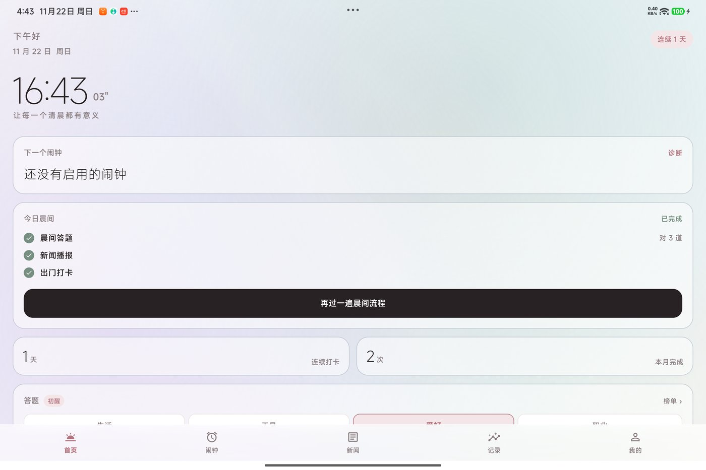

# 晨序 MORNING v1.12.1

**让每一个清晨都有意义。** 智能闹钟 + 晨间闭环：唤醒 → 答题提神 → 新闻播报 → 出门打卡。

## 本次更新（v1.12.1）

- 🔊 **播报音色修复**：真实新闻走系统 TTS 时，自动从引擎可用音色里挑选**本地中文女声**——此前被动用引擎默认音，在小米等设备上单薄刺耳
- 挑不出合适音色时保持引擎默认不变；全程本地挑选，不联网，断网可用
- versionName 1.12.1 / versionCode 19

## 关于本应用

| | |
|---|---|
| **系统要求** | Android 8.0 及以上 |
| **设备** | 手机、平板均可（平板横屏已适配） |
| **网络** | 闹钟/答题完全离线可用；新闻与语音播报需联网 |
| **体积** | 约 20MB，零第三方依赖 |

**核心功能**：
- ⏰ 系统级闹钟：锁屏直达全屏响铃页，灭屏/重启后依然有效，答题解锁贪睡
- 🧠 晨间答题：3224 道题库、10+ 分类，内置兴趣画像越答越懂你
- 📰 新闻播报：自动抓取当日新闻，一键连续播报 15 条，中文女声
- 📷 出门打卡：拍照打卡 + 连续记录 + 每日晨间汇总
- 🎨 三档玻璃质感主题，Android 8+ 自适应图标

## 怎么用（三分钟上手）

1. 安装后打开，到「我的 → 权限诊断」逐项授予通知、闹钟权限（MIUI/EMUI/ColorOS 建议允许自启动并关闭电池优化）
2. 「闹钟」标签右上角 ➕ 新建闹钟：时间、贪睡分钟、答题题数
3. 早上铃响 → 锁屏全屏响铃页 → 起床或先答题清醒
4. 首页「再过一遍晨间流程」→ 答题 → 新闻播报 → 出门拍照打卡 ✅

## 安装说明

直接下载下方 `morning-v1.12.1.apk` 安装。**从旧版本覆盖安装数据不丢**（闹钟、打卡记录、答题画像全部保留）。卸载重装会清空数据。

界面截图与完整介绍见仓库 [README](https://github.com/xia259214-beep/morning-app#readme)。
