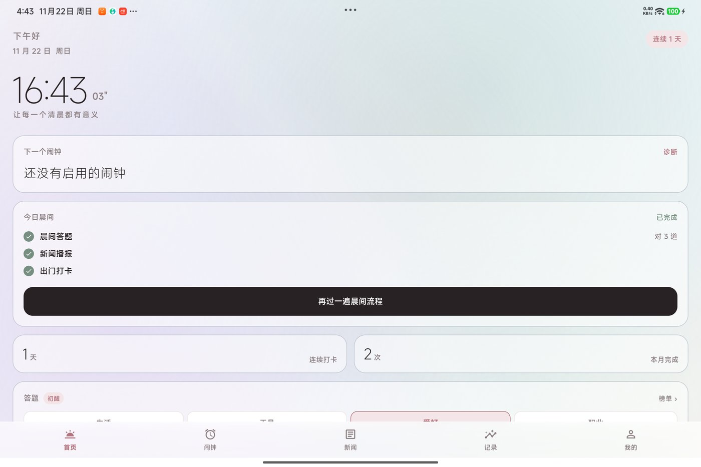

# 晨序 MORNING v1.13.1

**让每一个清晨都有意义。** 智能闹钟 + 晨间闭环：唤醒 → 答题提神 → 新闻播报 → 出门打卡。

## 本次更新（v1.13.1）—— 强制播报闭环

按用户设计的完整流程重构了响铃链路：

- 😴 **贪睡改成一天 2 次**：第一次响 →「贪睡 5 分钟」→ 第二次响 → 再「贪睡 5 分钟」→ 第三次响不再给按钮
- 📻 **第三次响铃 = 强制播报**：铃声自动换成当天新闻播报，页面上没有贪睡、没有关闭，返回键无效；**按 Home 键回到桌面，20 秒内也会被系统闹钟拉回播报页**（进程被 MIUI 冻结都能解冻拉回）
- 📷 **只有拍门外照片才能结束**：点「我已出门 · 去拍门外照片」→ 打卡页 → 拍照 → 比对通过 → 闹钟关闭、播报停止
- 🧭 **出门判定 v1（基准照比对）**：新增「我的 → 出门基准照」，先拍下门口 / 电梯 / 路边 / 小区门口的照片；打卡时自动比对——不像门外会拦下要求重拍，连拍 3 张未过按「存疑打卡」如实记录
- 判定局限（界面已写明）：夜里/大雾天会变宽松、对着基准照翻拍能绕过。它的作用是让「躺着拍天花板」过不去；定位/步数/Wi-Fi 切换等更强证据链在 V2 规划中
- versionName 1.13.1 / versionCode 22 ｜ 183 项测试全过 ｜ 真机全链路实测通过

## 关于本应用

| | |
|---|---|
| **系统要求** | Android 8.0 及以上 |
| **设备** | 手机、平板均可（平板横屏已适配） |
| **网络** | 闹钟/答题完全离线可用；新闻与语音播报需联网 |

**核心功能**：
- ⏰ 系统级闹钟：锁屏直达全屏响铃页，灭屏/重启后依然有效，贪睡两次后强制播报
- 🧠 晨间答题：3224 道题库、10+ 分类，内置兴趣画像越答越懂你
- 📰 新闻播报：自动抓取当日新闻，一键连续播报 15 条，自动挑选中文女声音色
- 📷 出门打卡：拍照 + 基准照比对 + 连续记录
- 🎨 三档玻璃质感主题，Android 8+ 自适应图标

## 怎么用（三分钟上手）

1. 安装后到「我的 → 权限诊断」逐项授权；MIUI 建议允许自启动、关电池优化
2. **「我的 → 出门基准照」拍 3 张**（门口/电梯/路边/小区门口）——不登记的话打卡只留证、不做比对
3. 「闹钟」标签 ➕ 新建闹钟：时间、贪睡分钟、答题题数
4. 早上铃响 → 贪睡最多两次 → 第三次直接听新闻播报 → 起身出门 → 拍一张门外照片 → 闹钟结束 ✅

## 安装说明

下载 `morning-v1.13.1.apk` 直接安装；**覆盖安装数据不丢**（含已登记的基准照）。卸载重装会清空数据。

界面截图与完整介绍见仓库 [README](https://github.com/xia259214-beep/morning-app#readme)。
